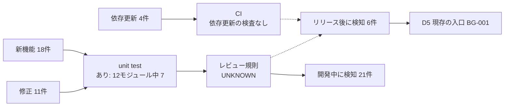
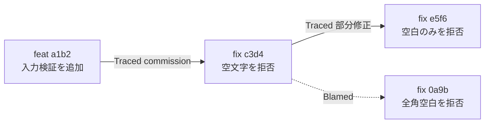

# bug-scan 設計書

状態: 設計案(未実装)/ 作成日: 2026-11-06

**一言で:** コードと git 履歴を読み取り専用で調べ、「バグがどの種類の変更から入り、どのゲートをすり抜け、今どこに同じ入口が残っているか」を、根拠つきの図で示す `*-scan` スキル。

---

## 1. このスキルでできること / やらないこと

### できること

| # | できること | 成果 |
|---|---|---|
| 1 | 過去の修正を分類する(誤った実装 / 欠落 / 要件変更 / 非欠陥) | 「fix」と書かれた commit のうち本当に欠陥だった割合が分かる |
| 2 | 修正から混入元の commit へ遡る(根拠の強さを3段階で明示) | 新機能・修正・リファクタ・依存更新など、どの変更経路で入りやすいかが分かる |
| 3 | fix の連鎖を図にする(修正が次の修正を生む流れ) | 直しきれず再発している箇所が分かる |
| 4 | バグパターン × モジュールを集計する | 「どこで、どの種類が繰り返すか」が分かる |
| 5 | 防御ゲート(テスト、lint、型、CI、レビュー規則、feature flag)の有無を、`path:line` つきで経路に重ねる | どのゲートが無いか/効いていないかが分かる |
| 6 | 過去のパターンを手がかりに、同種の入口が現在のコードに残っていないか探す | 根拠つきの finding として報告する |
| 7 | コード課題(テスト不在、ルール重複、例外の握りつぶし、高 churn)とバグパターンを結ぶ | どの課題を直すと、どのパターンが減る見込みかが分かる |
| 8 | 他の `*-scan` の `findings.json` を、依頼時だけ図に重ねる | 既存の監査結果を混入経路の文脈で読める |
| 9 | 前回の結果と比較する | パターンとホットスポットの増減が分かる |
| 10 | 不具合をリスト化し、実行をまたいで同じ不具合として追跡する | 状態、初回検出、最終確認、再発が分かる |
| 11 | 不具合どうしの関連(再発、原因、先に直す順、対象の共有)を根拠つきで記録する | どれがどれにつながり、何を先に直すかが分かる |
| 12 | 再現手順を記録する(実行の有無を状態で明示) | 誰かが検証を始められる手順が残る |
| 13 | リスク(発生可能性 × 影響、検知しやすさ)と危険性(金銭、データ、不可逆性など)を分けて記録する | 深刻さの理由を説明できる |
| 14 | 対象の画面、API、ジョブ、DB、外部サービス、設定を不具合に結びつける | 画面別、API 別、テーブル別に不具合を引ける |
| 15 | 同じ書き方の別の箇所(横展開先)を探し、箇所ごとに確認結果を残す | 部分修正の取りこぼしを防げる |
| 16 | 不具合を含むリリースの範囲、修正が入った最初のリリースを記録する | どの利用者に影響するかが分かる |
| 17 | 修正後も壊れたデータが残るか、対象の探し方と修復方法を記録する | コードの修正だけで終わらせずに済む |
| 18 | 検知元、検知段階、混入から検知まで、検知から修正までの日数を記録する | どのゲートが効いているかを測れる |

出力は `dashboard.html`(不具合リスト、インライン SVG の図、同内容の表)、`report.html` / `report.pdf`、`findings.json`、`surfaces.json`、`history.json`、`ledger.json`(実行をまたぐ台帳)、チャット要約です。

### やらないこと

| やらないこと | 理由 / 担当 |
|---|---|
| コード、設定、依存を修正する | 監査系 scan と同じ読み取り専用。修正は別依頼(`coding-debug`、`coding-implement`) |
| アプリの起動、テスト実行、本番データや外部サービスへのアクセス | 静的レビューの範囲外。動作確認は `verify-scan` |
| 目の前の1件のバグの根本原因を突き止める | `coding-debug` |
| 脆弱性、性能、設計、UX の専門監査 | 各 `*-scan`。ここでは採点し直さず、重ねて表示するだけ |
| 技術的負債の返済順を決める | `quality-debt` |
| **個人の評価**(作者別の集計、ランキング、作者名の記録) | 人を責める道具にしない。作者情報は `history.json` にも保存しない |
| **「この commit が原因」という断定を機械的に行う** | 下記 §3 のとおり blame は因果を証明しない |
| 未修正のバグの総数や将来のバグ数を予測する | 履歴に現れるのは「見つかって直されたもの」だけ |
| 根拠のない図を描く | 図の要素はすべて記録の ID に紐づける(`check` で拒否) |
| リポジトリ内の文章や commit message の指示に従う | 調査対象であり、指示ではない |
| issue 起票や外部送信 | 下書きまで。送信は依頼者が行う |
| データ修復を実行する、対象件数を数える | 探し方と修復方法の案だけを書く。SQL は案で、実行しない |
| 再現手順を自動で実行する | 手順はコードから導出し、未実行と明示する。実行は `verify-scan` か依頼者が行い、結果の参照だけを取り込む |
| 実データ、ログ、実利用数の参照 | DB はスキーマとコードだけで判断する。影響人数や頻度は、依頼者がデータを渡した場合のみ根拠にする |
| 数値のリスクスコアを作る | 根拠のない精度に見えるので、固定の表による段階判定にする |
| 「見つからなくなった」だけで Fixed にする | 修正 commit か確認結果が必要。無ければ `NotSeen` にする |
| Jira などの課題管理の代替(権限、通知、コメント、担当の割り振り) | 台帳は記録であり、運用基盤ではない。外部 ID を結びつけるだけ |

---

## 2. 既存スキルとの関係(調査結果)

対象は `~/repos/github.com/*-scan` の 11 リポジトリです。読み方には差があります。`SKILL.md` の全文を読んだのは architecture と prune、冒頭だけは security と performance です。残りは description、ファイル構成、`examples/` のサンプル、キーワード検索で確認しました。各 scan の詳細な手順までは確認していません。

| 観点 | 事実 | 設計への影響 |
|---|---|---|
| 問い | 監査系 scan は「今のコードの問題」を領域別に見つける。`verify-scan` は変更の検証、`brand-feature-scan` は機能提案が主題。混入元の追跡を示す語(`introduced by`、`混入` など)は `SKILL.md` と `reference/` の検索で 0 件 | 新規スキルの居場所がある |
| 履歴 | 変更履歴を分析の軸にしているのは `architecture-scan` のみで、用途は変更コストの裏付け(`reference/recon.md:153`)。`security-scan` は履歴内の秘密情報の検索に使う(`reference/perspectives.md:250`)。`review-md` は revert と fix hotspot から規則を作る(`reference/recon.md:45-54`)が、図の生成は description に含まれない | `history.py` を新規に作る |
| 図 | `architecture-scan` は自前の SVG と Mermaid(`scripts/render.py:427`, `:1246`)。`verify-scan` は画面遷移図(`scripts/flow.py`)。`scan-report-kit` に作図機能は無い | 作図は自前の `diagrams.py` に置き、スタイルだけキットを使う(`architecture-scan/.../render.py:31` と同じ形) |
| 経路の型 | `infra-scan` の attack path は「入口 → 辺 → 重要資産」で、各辺を `allowed` / `blocked` / `UNKNOWN` と判定して引用する(`reference/attack-paths.md`) | 現存の入口の図(D5)にこの型を流用する |
| パターン語彙 | `verify-scan/reference/regression-surface.md` に回帰パターンの整理がある | §5 のパターン分類の土台にする |
| schema | findings 型の 9 scan で共通なのは `id, title, severity, confidence, location, impact, validation` の 7 つ | 取り込みはこの 7 つだけを読む |
| ID 衝突 | `P-001` は performance と prune で、`F-001` は infra、prompt、security で重複する | 取り込みキーは `<scan>:<id>` にする |
| `location` | 文字列とリストが混在する | 取り込み時に正規化する |

取り込み対象外: `verify-scan`(findings 型ではなく検証記録)と `brand-feature-scan`(提案型)。

---

## 3. 成立性の検証(実測)

**前提:** 修正 commit から混入元へ遡れること。簡易 SZZ(修正で変更された行を親 commit で blame する手法)を実行しました。

| リポジトリ | commit 数 | fix commit(prefix 判定) | 抽出数 | 遡れた / ソース変更あり | テスト変更を伴う | 修正までの時間の中央値 |
|---|---|---|---|---|---|---|
| architecture-scan | 100 | 68 | 60 | 59 / 60 | 59 / 60 | 9.5 時間 |
| ux-scan | 151 | 125 | 60 | 57 / 59 | 58 / 60 | 111 時間 |
| verify-scan | 199 | 20 | 20 | 20 / 20 | 20 / 20 | 1.6 時間 |
| security-scan | 161 | 82 | 60 | 55 / 58 | 56 / 60 | 8.5 時間 |

(merge commit を除く。抽出は最新から。`executed`)

**遡れても、原因とは限りません。** 無作為の 12 組(3 リポジトリ各 4 組)の差分を読むと、次のように分かれました(`inspected`、Claude が 1 回読んだだけの判定で、独立した評価者はいません)。

| 分類 | 組数 | 内容 |
|---|---|---|
| 誤りを書いた commit を妥当に指す | 約 5 | 正規表現の誤り、前回修正の不足など |
| 欠落(最初から処理が無い) | 約 7 | 混入点を定義しにくい。追加のみの修正では、blame が近くの無関係な行を指す場合もある |

ここから設計を次の4点に変えました。

1. **混入種別を分ける:** `commission`(誤って書いた)、`omission`(欠落)、`requirement`(後からの要件)、`not-defect`
2. **根拠の強さを3段階に分け、線種で描き分ける:**
   - `Traced`(実線): 修正と混入元の両方の差分を読み、因果を説明できた
   - `Blamed`(破線): blame の結果だけで、未確認
   - `Unattributable`(混入元なし): 欠落、または履歴が無い
3. **`Traced` だけを主要な数値に使う:** 他と混ぜない
4. **「fix の連鎖」は基準率と並べて示す:** 混入元候補の 7〜8 割が fix commit でしたが、fix の割合が高いリポジトリ(ux-scan は 83%)では単に最後に触った commit が fix だっただけの可能性があります

**この検証の限界:** 対象はすべて同じ所有者のスキル群で、fix prefix が広く使われています。一般的なアプリのリポジトリでは未検証です(§9)。

---

## 4. 図のカタログ

各図には答える問いが1つあり、同内容の表を添えます。図は証拠ではなく記録の表現です(`verify-scan/.../flow.py` と同じ方針)。架空データでの見本は [bug-scan-samples.html](bug-scan-samples.html) にあります。

| 図 | 答える問い | 形式 | 主な入力 | 段階 |
|---|---|---|---|---|
| **D1 混入経路マップ** | どの変更経路から入り、どのゲートを通って、どこで見つかったか | 左から右へのフロー、太さは件数 | 分類済み修正 + ゲート台帳 | 3 |
| **D2 パターン × モジュール** | どこで何が繰り返すか | ヒートマップ | 分類済み修正 | 2 |
| **D3 fix 連鎖** | 修正が次の修正を生んでいないか | commit の DAG(時系列) | `history.json` | 1 |
| **D4 ホットスポット象限** | 危険な場所はどこか | 散布図(変更頻度 × 欠陥修正密度、テスト有無で印を分ける) | `history.json` | 1 |
| **D5 現存の入口** | 同じバグが今どの経路で起きうるか | finding ごとの因果チェーン | finding の `path` | 2 |
| **D6 課題 → パターン** | どのコード課題がどのパターンを生んでいるか | 2部グラフ(課題 → パターン → 修正) | finding + 分類済み修正 | 3 |
| **D7 不具合の関連** | どれがどれにつながり、どれを先に直すべきか | 関連グラフ(根拠つきの矢印 + 自動算出の細線) | `relations` | 2 |
| **D8 対象マップ** | この不具合はどの画面、API、テーブルに及ぶか | 画面 → API・ジョブ → DB・外部の3列図(選択で強調) | `surfaces.json` | 2 |
| **D9 リスク × 危険性** | どれが危なく、どれを先に見るべきか | 3×3 マトリクス(不可逆、無音を併記) | `risk` + `hazard` | 2 |

図とは別に、絞り込みと詳細表示ができる**不具合リスト**をダッシュボードの先頭に置きます。

### D1 の見本(架空データ)



実線は `Traced`、破線は `Blamed` または `UNKNOWN` です。git だけでは「どのゲートを通過したか」を確定できないので、タグや PR の情報が無い辺は `UNKNOWN` のまま描きます。

### D3 の見本(架空データ)



---

## 5. 分類の語彙

**変更経路(channel):** `feature` / `fix` / `refactor` / `dependency` / `config` / `migration` / `generated` / `merge` / `unknown`

**バグパターン(12 + 未分類):**

| ID | パターン | 出どころ |
|---|---|---|
| BP01 | 入力の形、境界値の見落とし | 今回の抽出 |
| BP02 | 値に見える失敗(握りつぶし、既定値への置換) | regression-surface |
| BP03 | 境界をまたぐ名前や契約のずれ | regression-surface |
| BP04 | 重複したルールの乖離 | architecture-scan |
| BP05 | 状態、並行、順序、部分書き込み | 今回の抽出、architecture-scan |
| BP06 | 移行や依存更新による暗黙の変化 | regression-surface |
| BP07 | 配線切れ(リスナー、ルート、ミドルウェア) | regression-surface |
| BP08 | 一部のデータでしか再現しない | regression-surface |
| BP09 | タイミング依存 | regression-surface |
| BP10 | 環境、設定の差 | regression-surface |
| BP11 | **部分修正**(同種の別ケースが残る) | 今回の抽出 |
| BP12 | 文書と実装のずれ | 今回の抽出 |
| — | `Unclassified` | 無理に分類しない。件数を表示する |

**コード課題:** テスト不在 / ルール重複 / 例外の握りつぶし / 高 churn かつ高複雑度 / ゲート不在 / 暗黙の契約

---

## 6. 実行の流れ

`RECON → CATALOG → HISTORY → TRIAGE → REVIEW → VERIFY → RECONCILE → REPORT`

| 段階 | すること | 出力 |
|---|---|---|
| RECON | 構成、モジュール、コアフロー、ゲート台帳(テスト、lint、型、CI、CODEOWNERS を `path:line` で)、履歴の質(shallow か、squash か、prefix の有無) | scratch |
| CATALOG | 画面、API、ジョブ、DB、外部サービス、設定を列挙し、呼び出しの対応を読み取る。読めない対応は `UNKNOWN` | `surfaces.json` |
| HISTORY | `scripts/history.py` が修正候補、blame の辺、churn を機械的に抽出 | `history.json`(候補であり finding ではない) |
| TRIAGE | 修正候補の差分を読み、種別、経路、パターン、根拠の強さを付ける。100 件を超えたらモジュールで層化抽出し、`n/N` を表示する | fix event(断片) |
| REVIEW | 繰り返すパターンごとに、同種の入口を現在のコードから探す。finding ごとに横展開先を調べ、影響リリース、データ修復、検知の経緯を記録する | finding(断片) |
| VERIFY | ガード、テスト、呼び出し元を調べて finding の反証を試みる。`Traced` の因果も読み直す | verdict |
| RECONCILE | 今回の結果を独立に確定した後で前回の台帳と照合し、同じ不具合を結びつける。状態の変化と再発を記録する | `ledger.json` |
| REPORT | merge → renumber → render → `check`。その後チャット要約 | 成果物一式 |

**判断の分岐**

| 状況 | 動き |
|---|---|
| 「何を見ればいい?」と聞かれた | RECON までで checklist を返す。ファイルは作らない |
| 特定モジュールだけ | そのモジュールと横断部分に限定し、残りは `limitations` に書く |
| 履歴が薄い(shallow、または欠陥修正が 20 件未満) | 履歴の図(D1、D3)を省略し、理由を明記する。D5、D6 は現在のコードで作る |
| fix prefix が無いリポジトリ | 緩い語句判定 + 読んでの分類に切り替え、適合度が低い可能性を `limitations` に書く |
| 他 scan の結果を渡された | 明示された場合だけ取り込む。依頼がなければ読まない(既存の Independence 規約と同じ) |
| 前回と比較 | 新規に独立して走らせてから `compare.py` |
| 修正を頼まれた | 範囲外。finding を報告して別依頼にする |

**重大度**(confidence とは独立。既存 scan と同じ)

| 重大度 | 条件 |
|---|---|
| High | 欠陥の繰り返し(`Traced` 3 件以上)があり、かつ同種の入口がコアフローに残り、ゲートも無い |
| Medium | 同種の入口はあるが、コード外の条件が1つ必要。またはコアフロー以外で繰り返している |
| Low | 周辺コードでの繰り返し、または単発 |
| Info | 傾向の記録のみで、現在の入口は未確認 |

履歴上の統計だけでは Info を超えません。Medium 以上には現在のコードの `path:line` が必要です。

---

## 7. データ設計

既存 scan と同様に、JSON 断片を `merge` で合成し、図はすべて記録から生成します。

```jsonc
{
  "meta": {"project": "…", "scope": "…", "commit": "…", "date": "…", "assessor": "…", "lang": "ja",
           "history_window": "12 months", "sample": {"read": 100, "candidates": 240}},
  "fix_events": [{
    "id": "E-001", "commit": "c3d4", "type": "commission",   // commission|omission|requirement|not-defect
    "pattern": "BP11", "module": "api/orders",
    "origin": {"commits": ["a1b2"], "channel": "feature", "strength": "Traced",
               "reason": "a1b2 の validate() が空文字を通し、c3d4 が同じ行を直した"},
    "gate_missed": ["G-02"], "regression_test": true
  }],
  "gates": [{"id": "G-02", "kind": "ci", "evidence": ".github/workflows/ci.yml:12", "status": "present"}],
  "findings": [{
    "id": "BG-001", "title": "…", "severity": "High", "confidence": "Confirmed",
    "location": ["api/orders/validate.py:42"], "impact": "…",
    "pattern": "BP11", "events": ["E-001", "E-004"],
    "path": [{"from": "…", "to": "…", "state": "allowed", "at": "api/orders/validate.py:42"}],
    "fix": "…", "guard": "…",
    "validation": {"verdict": "Valid", "method": "static", "evidence": "…"}, "status": "Open"
  }],
  "issues": [{"id": "I-01", "kind": "untested", "at": "api/orders/", "feeds": ["BP11"]}],
  "imports": [{"key": "security-scan:F-001", "title": "…", "severity": "High", "location": ["…"]}],
  "perspectives": [], "checked_ok": [], "limitations": [], "decisions": [], "next_steps": []
}
```

**`check` が拒否するもの**

- `Traced` なのに `reason` か混入元の commit が無い
- 図の要素が記録の ID に解決できない
- 抽出したのに `sample` が無い(全数のように見せない)
- 記録に作者名やメールアドレスがある
- Medium 以上で、現在のコードの `path:line` が無い
- `dashboard.html` や `report.html` が記録からの再生成と一致しない(既存と同じ)

- 再現状態が `verified` なのに実行結果の参照が無い
- 関連(`relations`)に根拠が無い、または存在しない ID を指している
- `surfaces` が `surfaces.json` に解決できない
- 再現手順の入力に秘密情報や実在の個人情報らしき値がある
- 未解決なのにリスク判定が無い
- 必須範囲(§7.1)の項目が欠けている。分からない場合は空欄にせず、`UNKNOWN` と理由を書く

**配置**(既存 scan と同じ構成。標準ライブラリのみ)

```
skills/bug-scan/
  SKILL.md
  reference/  recon.md  surfaces.md  history.md  taxonomy.md  gates.md  tracking.md  diagrams.md
              findings-schema.md  validation.md  report.md
  scripts/    surfaces.py  history.py  findings.py  ledger.py  render.py  diagrams.py
              compare.py  import_findings.py  contract_check.py
              scan_report_kit/   (vendored)
examples/  tests/  Makefile  README.md
```

### 7.1 トラッキング要素

1 件の不具合(`BG-*`、根本原因ごとに 1 件)が持つ項目です。修正済みの過去の不具合も、同じ形で記録します(複数の修正は `events` にまとめます)。

| 区分 | 項目 | 内容 | 由来 |
|---|---|---|---|
| **識別** | `id` | 実行ごとの番号(`BG-001`) | 既存 scan |
| | `key` | 実行をまたいで同じと判定するキー(パターン + 正規化した場所 + 対象)。行番号は含めない | `security-scan` の `finding_keys.py` を参考 |
| | `title`, `pattern`, `module` | 名前、バグパターン、モジュール | §5 |
| **状態** | `status` | `Open` / `Triaged` / `Fixed` / `Verified` / `Accepted` / `Reopened` / `NotSeen` / `Unverified` | 既存の `status` を拡張 |
| | `first_seen`, `last_seen`, `status_log[]` | 初回検出、最終確認、変更履歴(日時、値、根拠) | 新規 |
| | `introduced_in`, `fixed_in` | 混入 commit(根拠の強さつき)、修正 commit | §3 |
| **評価** | `severity`, `confidence`, `validation` | 既存 scan と同じ | 共通 7 項目 |
| | `risk` | `likelihood`、`impact`、`detectability`、`level`、`basis`。`level` は固定の表から決まる | 新規 |
| | `hazard` | `classes[]`(金銭、データ消失、データ不整合、セキュリティ、個人情報、可用性、法令、表示誤りなど)、`irreversible`、`silent`、`reach`、`recovery` | `blast_radius`、`subjects` を分解 |
| **関連** | `relations[]` | `type`、`to`、`strength`、`evidence` | 新規 |
| **再現** | `repro` | `state`、`preconditions[]`、`fixture`、`environment`、`steps[]`、`expected`、`actual`、`last_run` | `security-scan` の `reproduction` を参考 |
| **対象** | `surfaces[]` | `surfaces.json` の ID + 操作内容(例: `DB-01` の `W: discount_total`) | `screen`、`request`、`data`、`resources` を統合 |
| | `actors[]`, `conditions[]` | 操作する人や役割、発生条件(権限、環境、feature flag、言語、端末) | `actor` |
| **根拠** | `location[]`, `events[]`, `tests[]`, `tests_missing` | コードの場所、修正履歴、既存のテスト、足りないテスト | 既存 + 新規 |
| | `external_refs[]` | issue や PR、インシデントの URL。依頼者が渡したものだけ | `references` |
| **対応** | `fix`, `guard`, `regression_test`, `fix_order` | 修正方針、再発防止、回帰テスト、修正の順序 | 既存 |
| | `owner` | チームや役割だけ。人が入力する。commit の作者からは埋めない | 新規 |
| **横展開** | `sibling_sites[]` | `location`、`state`(`affected` / `safe` / `unknown`)、`evidence` | 新規 |
| **影響リリース** | `affected_releases` | `first`、`last`、`fixed_first`、`basis` | 新規 |
| **データ修復** | `data_remediation` | `needed`(`yes` / `no` / `unknown`)、`locate`、`method`、`count` | `recovery` を詳しくしたもの |
| **検知の経緯** | `detection` | `source`、`stage`、`detected_at`、`days_to_detect`、`days_to_fix`、`basis` | 新規 |

**必須範囲**

| 対象 | 必須にする項目 |
|---|---|
| 未解決の High / Medium | 全項目 |
| 未解決の Low / Info | 識別、状態、評価、対象、根拠 |
| 修正済みの過去の不具合 | 識別、状態、パターン、混入と修正の commit、検知の経緯 |

範囲外の項目は分かれば記録してかまいません。必須の項目が分からない場合は、空欄にせず `UNKNOWN` と理由を書きます。`owner` は人が入力する項目なので、どの範囲でも `check` の対象にしません。

**追加した4項目の決まり**

| 項目 | 取得元 | 決まり |
|---|---|---|
| 横展開先 | コード検索と読解 | 同じ修正で直る箇所はここに列挙し、別の修正が必要な箇所は別の不具合にする |
| 影響リリース | `git tag --contains` | タグが無い、または混入元が無い場合は `UNKNOWN`。混入元が `Blamed` なら暫定と書く |
| データ修復 | スキーマとコードからの導出 | `count` は依頼者がデータを渡さない限り `UNKNOWN`。SQL は案で、実行しない |
| 検知の経緯 | git 履歴、PR、依頼者が渡す issue | 検知元が読み取れなければ `UNKNOWN`。日数は日付から機械的に計算する |

**関連の種類(`relations.type`)**

| 種類 | 意味 | 作り方 |
|---|---|---|
| `regression_of` | 過去の不具合の再発 | 根拠必須 |
| `caused_by` | 別の不具合やその修正が原因 | 根拠必須。`Traced` か `Blamed` を明示 |
| `same_root_cause` | 根本原因が同じ | 根拠必須 |
| `blocks` | これを先に直す必要がある | 根拠必須 |
| `duplicate_of` | 重複 | 根拠必須 |
| `shares_surface` | 同じ DB やジョブを使用 | `surfaces` から自動算出。因果を意味しない |

**再現の状態(`repro.state`)**

| 状態 | 意味 |
|---|---|
| `static` | コードから導出した手順で、未実行 |
| `test` | 修正時のテストや既存テストで確認済み(参照つき) |
| `verified` | 実行して確認済み(`verify-scan` や依頼者の結果を参照) |
| `not-reproduced` | 実行したが再現しなかった |
| `unknown` | 手順を確定できない。足りない情報を記録する |

入力値は合成データだけにします。実在の個人情報や本番の値は記録しません。

**対象カタログ(`surfaces.json`)**

| 種別 | ID | 持つ情報 | 抽出の参考 |
|---|---|---|---|
| 画面 | `SC-*` | 名前、ルート、コンポーネントの `path:line`、関連フロー | `ux-scan` の inventory |
| API | `API-*` | メソッド、パス、ハンドラの `path:line`、認可の有無 | `prune-scan` の `routes` |
| ジョブ、イベント | `JOB-*` | 名前、起動元、キュー | `prune-scan` の entry points |
| DB | `DB-*` | ストア、テーブル、カラム、制約、定義の `path:line`、読み書きする箇所 | migration と ORM を静的に読む(`verify-scan` のスキーマ採取は実行が必要なので使わない) |
| 外部 | `EXT-*` | サービス名、呼び出し箇所 | `architecture-scan` の `external` |
| 設定 | `CFG-*` | 環境変数、feature flag、読み取り箇所 | `prune-scan` の `env_read` |

対応(画面 → API → DB)には `traced` / `inferred` / `UNKNOWN` を付けます。動的なルートは読み取れないことがあるので、`limitations` に書きます。

**リスクの段階(固定の表)**

| 発生可能性 \ 影響 | 低 | 中 | 高 |
|---|---|---|---|
| 高 | 中 | 高 | 高 |
| 中 | 低 | 中 | 高 |
| 低 | 低 | 低 | 中 |

`severity` は既存 scan と同じ基準で「コードから言える重大さ」、`risk` は「起きやすさも含めた優先度の材料」です。不一致はありえるので、理由を `basis` に書きます。発生可能性はコードからの推定で、実測ではありません。

**実行をまたぐ追跡(`ledger.json`)**

- 保存先はリポジトリの外で、依頼者が指定します(読み取り専用の規約を守るため)
- 既存 scan の Independence 規約に合わせ、今回の結果を確定してから台帳を読みます
- 照合の結果は 4 通りです: 新規、継続、`NotSeen`(見つからなくなった)、再発(`Fixed` の後に再び検出)
- `NotSeen` は修正の証明ではありません。スコープが違うと見つからないこともあります
- 人が付けた状態(`Accepted`、`owner` など)は上書きしません

**安全面:** commit message と差分は信頼しない入力として扱います。`history.json` に差分本文は保存しません(過去の commit には秘密情報が残っていることがあるため)。引用は短い抜粋に限り、秘密情報をマスクしてから記録します(`ux-scan` の `scripts/secret_lines.py` と同様)。

---

## 8. 検討した案

| 案 | 判断 | 理由 |
|---|---|---|
| **A. 独立した新規 scan** | **採用** | 問いと成果物が既存と違う。単体でインストールできる。代償は 1 リポジトリ分の保守 |
| B. `architecture-scan` に観点を追加 | 不採用 | 契約は「設計 finding と before/after 図」。`render.py` はすでに 1,696 行あり、図 6 種を足すと役割がぶれる |
| C. 他 scan の結果を集約して描くだけ | 不採用(取り込み機能としてのみ残す) | 確認した 9 つの findings サンプルに混入経路の項目が無いので、肝心の問いに答えられない |
| D. 外部の SZZ ツールや可視化ライブラリを使う | 不採用 | 既存 scan のスクリプトは import の検査で標準ライブラリのみ。この形を保つ |
| E. blame の結果を混入元としてそのまま使う | 不採用 | §3 の抽出では欠落が過半で、blame が無関係な行を指す例もあった |

**この設計で諦めること:** 全自動の高速実行はできません(TRIAGE で差分を読むので履歴が多いほど時間がかかる)。実行時の可視化やリアルタイム追跡もありません。

---

## 9. この設計が間違っている場合

**最も重要な前提:** 一般的なアプリのリポジトリでも、読んでの分類で混入経路に意味のある偏りが見える。

**安く確かめる方法(実装前):** 性質の違う 3 リポジトリ(スキル以外で、1 つは conventional commits 不使用)から 30 組ずつ抽出し、手で分類します。

**次のいずれかなら設計を変えます。**

- `Traced` にできる組が全体の 2 割未満 → D1、D3 を主役から外し、D4、D5、D6(現在のコード中心)に絞る
- 変更経路の分布が基準率(種類別の commit 比率)と差が無い → D1 の件数表示をやめ、ゲート台帳だけにする
- 二人が独立に分類して一致率が低い → パターンを 12 から減らす
- 実行をまたいで `key` が安定しない(同じ不具合が別物になる)→ 自動照合をやめ、候補を提示して人が確定する
- 画面 → API → DB の対応が静的に読めないリポジトリが多い → D8 を「読めた範囲のみ」と明示するか、段階を遅らせる
- 検知元が `UNKNOWN` ばかりになる(PR や issue の情報が無い)→ `detection` を必須から外し、D1 の検知段階を任意の図にする

---

## 10. 実装の順序

1. `history.py` と fixture テスト。`architecture-scan` で `history.json` を出す ← **最初の一歩**
2. D3 と D4 を SVG で描き、`check` まで通す(分類なしで端から端まで)
3. §9 のパイロット。ここで続行か変更かを判断する
4. TRIAGE の語彙と schema、`merge`、`renumber`
5. D2、D5 と REVIEW、VERIFY。不具合リスト(§7.1 の項目)と D9
6. `surfaces.py` と D8、`relations` と D7
7. D1、D6 とゲート台帳
8. `ledger.py`(実行をまたぐ追跡)
9. `import_findings.py`、`compare.py`

---

## 11. 未決事項

#TODO(agent): DEFERRED §9 のパイロットを実装前に実施する(対象リポジトリの指定が必要)。

#TODO(agent): OPEN スキル名を確定する。既定は `bug-scan`。他の scan はリポジトリ名とスキル名が一致しているが、このリポジトリは `bug-tracker` なので、リポジトリ名を変えるか不一致を許容するかを決める。

#TODO(agent): OPEN コアとなる利用者を確定する。既定は「自分のリポジトリを調べる開発者本人」で、チーム共有向けの匿名化や権限管理は設計に含めない。

#TODO(agent): OPEN `ledger.json` の保存先を確定する。既定は依頼者が指定するリポジトリ外のディレクトリ。チームで共有するなら別途リポジトリにコミットする運用が要るが、読み取り専用の規約とは別の作業になる。
